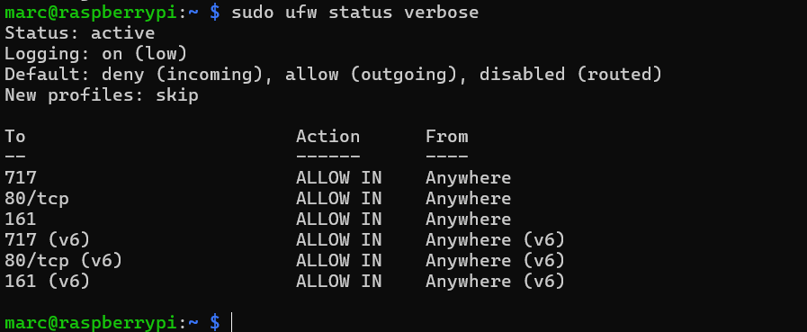

# UFW Firewall Configuration

> **Project:** Enterprise Infrastructure Homelab
>
> **Category:** Security
>
> **Status:** Completed
>
> **Purpose:** Restrict inbound network access to the Raspberry Pi so that only the services required by the homelab are reachable.

---

## Project Overview

This document covers the configuration of UFW (Uncomplicated Firewall) on the Raspberry Pi.

By default, every listening service on a device can be reached by any machine on the network. A host-based firewall reduces this attack surface by blocking all inbound traffic except for the services that are explicitly allowed.

The firewall policy follows the principle of least privilege: deny everything inbound, then allow only SSH for administration, HTTP for the Apache-hosted SNMP monitoring dashboard, and SNMP so the Zabbix Server can monitor the device.

---

## Objectives

- Enable a host-based firewall on the Raspberry Pi.
- Apply a default-deny policy for inbound traffic.
- Allow only the services required by the homelab.
- Configure firewall rules without losing SSH access.
- Keep Zabbix SNMPv3 monitoring working after the firewall is enabled.
- Enable firewall logging.

---

## Environment

| Property | Value |
|----------|---------|
| Device | Raspberry Pi |
| Operating System | Raspberry Pi OS (Debian GNU/Linux) |
| Firewall | UFW (Uncomplicated Firewall) |
| Web Server | Apache (SNMP monitoring dashboard) |
| SSH Port | TCP 717 (non-default) |
| Monitoring Server | Zabbix Server on Ubuntu Server (SNMPv3) |

---

## Firewall Policy

| Direction | Port / Service | Action | Reason |
|-----------|----------------|--------|--------|
| Incoming | Default | Deny | Block all traffic not explicitly allowed |
| Outgoing | Default | Allow | Allow package updates and normal outbound traffic |
| Routed | Default | Disabled | The Pi does not forward traffic for other devices |
| Incoming | 717 (SSH) | Allow | Remote administration on a non-default SSH port |
| Incoming | 80/tcp (HTTP) | Allow | Apache web server hosting the SNMP monitoring dashboard |
| Incoming | 161 (SNMP) | Allow | Zabbix Server polls the Pi over SNMPv3 |

Rules apply to both IPv4 and IPv6.

---

# Implementation

## Install UFW

UFW is not always included with Raspberry Pi OS by default.

### Commands

```bash
sudo apt update
sudo apt install ufw
```

---

## Set the Default Policies

All inbound traffic is denied unless a rule allows it. All outbound traffic is allowed.

### Commands

```bash
sudo ufw default deny incoming
sudo ufw default allow outgoing
```

---

## Allow SSH Before Enabling the Firewall

The Pi is administered remotely over SSH on port 717. This rule must be added **before** enabling UFW. Otherwise, the active SSH session is cut off and the Pi can only be recovered with a keyboard and monitor attached directly.

### Command

```bash
sudo ufw allow 717
```

---

## Allow HTTP

Apache on the Pi serves the SNMP monitoring dashboard on TCP port 80.

### Command

```bash
sudo ufw allow 80/tcp
```

---

## Allow SNMP for Zabbix Monitoring

The Zabbix Server queries the Pi's SNMP agent on port 161. Without this rule, the firewall blocks the requests and the Pi's SNMP items in Zabbix stop collecting data.

### Command

```bash
sudo ufw allow 161
```

---

## Enable the Firewall and Logging

### Commands

```bash
sudo ufw enable
sudo ufw logging low
```

UFW is now active, starts automatically at boot, and logs blocked connections to `/var/log/ufw.log`.

---

# Verification

## Review the Active Rules

### Command

```bash
sudo ufw status verbose
```

> **Screenshot**
>
> 

The output confirms:

- `Status: active`
- `Logging: on (low)`
- `Default: deny (incoming), allow (outgoing), disabled (routed)`
- Allow rules for ports 717, 80/tcp, and 161 on both IPv4 and IPv6

---

## Verify Service Access

| Test | Method | Expected Result |
|------|--------|-----------------|
| SSH access | `ssh -p 717 marc@<pi-ip>` | Login succeeds |
| Monitoring dashboard | Browser to `http://<pi-ip>` | Dashboard loads |
| SNMP monitoring | Zabbix host status for the Pi | SNMP items keep collecting data |

---

## Verification Summary

| Task | Status |
|------|--------|
| UFW Enabled | ✅ |
| Default Incoming Policy: Deny | ✅ |
| Default Outgoing Policy: Allow | ✅ |
| SSH (717) Allowed | ✅ |
| HTTP (80/tcp) Allowed | ✅ |
| SNMP (161) Allowed | ✅ |
| Logging Enabled | ✅ |
| Firewall Enabled at Boot | ✅ |

---

## Useful Commands

| Task | Command |
|------|---------|
| View rules with numbers | `sudo ufw status numbered` |
| Delete a rule | `sudo ufw delete <number>` |
| Allow from one IP only | `sudo ufw allow from <ip> to any port 161 proto udp` |
| Disable the firewall | `sudo ufw disable` |
| Reset all rules | `sudo ufw reset` |
| Check firewall logs | `sudo less /var/log/ufw.log` |

---

## Observations

- The order of steps matters: allowing the SSH port before enabling the firewall prevents an administrator lockout.
- Moving SSH to a non-default port reduces noise from automated scans that target port 22.
- A monitored device needs an inbound rule for its SNMP port, or monitoring silently stops once the firewall is enabled.
- A default-deny policy means any new service added to the Pi must be explicitly allowed before it can be reached.

---

## Technical Competencies Demonstrated

- Host-Based Firewall Configuration
- Linux Security Hardening
- Principle of Least Privilege
- Network Port and Protocol Management
- Monitoring and Firewall Integration
- Technical Documentation

---

## Lessons Learned

- Always allow the SSH port before enabling a firewall on a remotely managed device.
- Check which ports the monitoring system relies on before writing firewall rules.
- Verify every service after enabling the firewall, not just SSH.
- Start from deny-all and open only what is needed, rather than blocking ports one by one.

---

## Future Improvements

The current rules allow each port from any address and over both TCP and UDP. They can be tightened:

| Current Rule | Improvement | Command |
|--------------|-------------|---------|
| `161` from anywhere | Allow SNMP over UDP from the Zabbix Server only | `sudo ufw allow from <zabbix-server-ip> to any port 161 proto udp` |
| `717` (TCP and UDP) | Allow SSH over TCP only | `sudo ufw allow 717/tcp` |
| SSH from anywhere | Restrict SSH to the administration client | `sudo ufw allow from <admin-ip> to any port 717 proto tcp` |

Additional hardening planned:

- Apply the same firewall policy to the Ubuntu Server.
- Switch SSH to key-based authentication and disable password login.
- Add Fail2ban to block repeated failed login attempts.

---

## Repository Navigation

| ⬅ Previous | 🏠 Section Home | Next ➡ |
|------------|----------------|---------|
| [SNMPv3 Configuration for Raspberry Pi](../04-infrastructure-monitoring/02-snmp-configuration.md) | [Security](README.md) | — |
